

  

  
  
  

  CS and Physics student at UAB, open to Summer 2027 internships. 
  Here's what I've built, with demos and code.

 

<picture>
  <source media="(prefers-color-scheme: dark)" srcset="assets/h-featured-dark.svg">
  
</picture>

<table>
  <tr>
    <td width="56%">
      <a href="https://youtu.be/a-963WiK0cQ">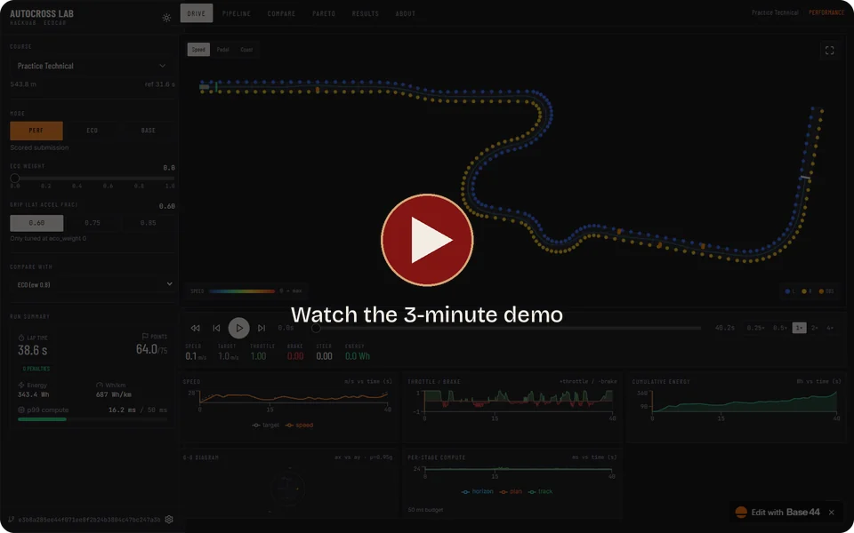</a>
    </td>
    <td width="44%" valign="top">
      <h3>HackUAB</h3>
      <b>1st place, HackBama_01 EcoCAR track</b>
      
A self-driving race-car controller my team of 3 built. With no map and only 40 m of course in view, the car plans a racing line, predicts whether its tires will hold, and makes a new driving decision every 50 ms.

      
<a href="https://github.com/rmaytr/HackUAB"><b>View code</b></a>&nbsp;&nbsp;&nbsp;<a href="https://youtu.be/a-963WiK0cQ"><b>Watch demo</b></a>&nbsp;&nbsp;&nbsp;<a href="https://uab-track-sync.base44.app"><b>Replay laps</b></a>

      Python, NumPy, CARLA
    </td>
  </tr>
</table>

<table>
  <tr>
    <td width="50%">
      <a href="https://github.com/rmaytr/HackUAB/blob/main/docs/RESULTS.md">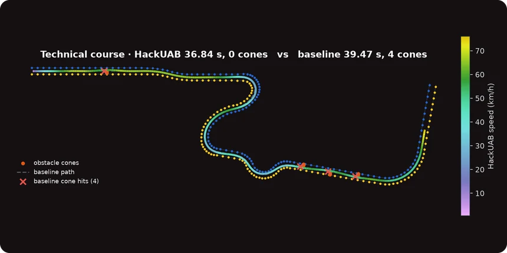</a>
    </td>
    <td width="50%">
      <a href="https://github.com/rmaytr/HackUAB/blob/main/docs/RESULTS.md">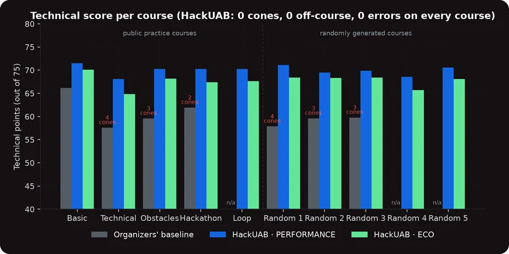</a>
    </td>
  </tr>
</table>

 

<picture>
  <source media="(prefers-color-scheme: dark)" srcset="assets/h-apps-dark.svg">
  
</picture>

<table>
  <tr>
    <td width="50%" valign="top">
      <a href="https://cairn-tasks-tawny.vercel.app/">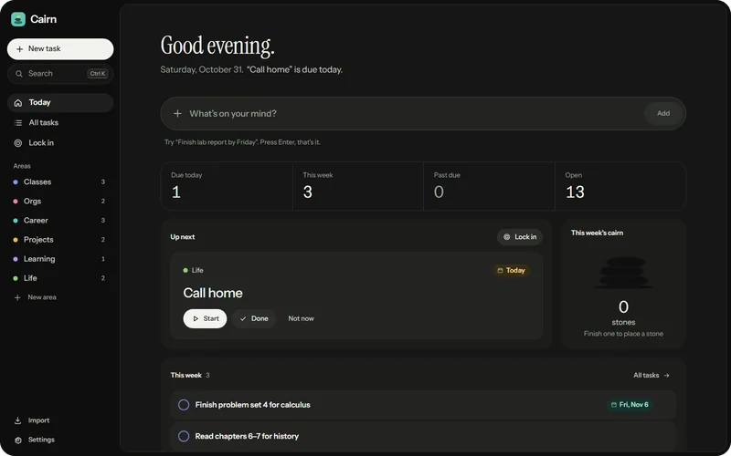</a>
      <h3>Cairn</h3>
      
A calm task planner for people who get overwhelmed by long lists. You type a task in plain words, and Cairn shows you one next step instead of the whole list. It works offline, with an optional AI assistant and encrypted sync.

      
<a href="https://cairn-tasks-tawny.vercel.app/"><b>Try it</b></a>&nbsp;&nbsp;&nbsp;<a href="https://github.com/rmaytr/Cairn_Task_Tracking_App"><b>View code</b></a>

      React, TypeScript, Supabase
    </td>
    <td width="50%" valign="top">
      <a href="https://github.com/rmaytr/CanvasAssignmentTrackingBot">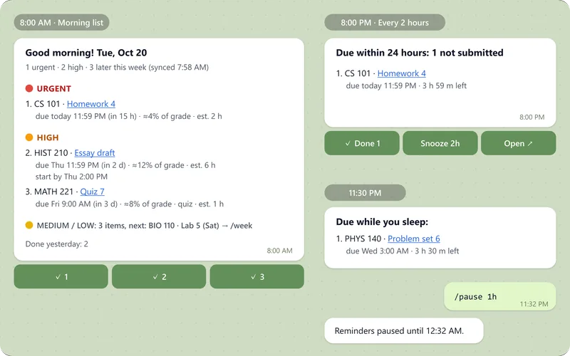</a>
      <h3>Canvas Assignment Tracker</h3>
      
A Telegram bot that pulls your assignments from Canvas, ranks them by grade weight, urgency and effort, and keeps reminding you until the work is done. It's in private beta with 6 students.

      
<a href="https://github.com/rmaytr/CanvasAssignmentTrackingBot"><b>View code</b></a>

      Python, asyncio, SQLite, Docker
    </td>
  </tr>
</table>

 

<picture>
  <source media="(prefers-color-scheme: dark)" srcset="assets/h-games-dark.svg">
  
</picture>

<table>
  <tr>
    <td width="33%" valign="top">
      <a href="https://pigeon-problems.vercel.app/">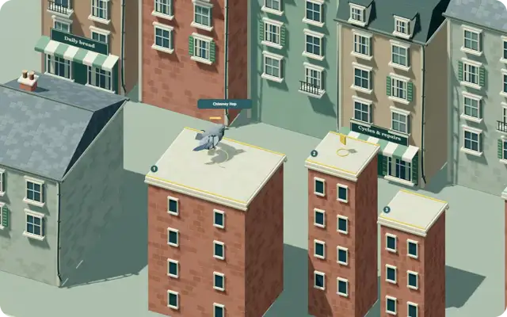</a>
      <h3>Pigeon Problems</h3>
      
A co-op 3D game for 1–4 players, set at a rooftop delivery company run by pigeons. The server runs the game and each browser predicts ahead, so it stays playable under lag.

      
<a href="https://pigeon-problems.vercel.app/"><b>Play</b></a>&nbsp;&nbsp;&nbsp;<a href="https://github.com/rmaytr/Pigeon-Problems"><b>View code</b></a>

      Three.js, WebSockets, Cloudflare Workers
    </td>
    <td width="33%" valign="top">
      <a href="https://hollow-alibi.smoky-harp-3438.chatgpt.site/">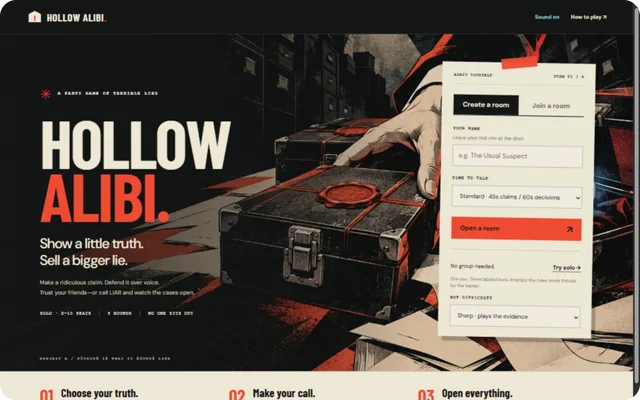</a>
      <h3>Hollow Alibi</h3>
      
A bluffing game for 2–10 players. Your case is secretly full or empty, and you show just enough evidence to sell your story. It also has solo bots and voice chat.

      
<a href="https://hollow-alibi.smoky-harp-3438.chatgpt.site/"><b>Play</b></a>&nbsp;&nbsp;&nbsp;<a href="https://github.com/rmaytr/Hollow-Alibi"><b>View code</b></a>

      TypeScript, WebRTC, Cloudflare Workers
    </td>
    <td width="33%" valign="top">
      <a href="https://raincheck-raccoons.vercel.app">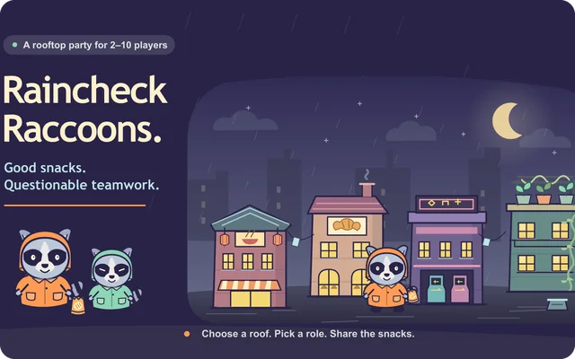</a>
      <h3>Raincheck Raccoons</h3>
      
A rooftop snack-heist party game for 2–10 players. Everyone makes a private choice, then all the choices are revealed at once.

      
<a href="https://raincheck-raccoons.vercel.app"><b>Play</b></a>&nbsp;&nbsp;&nbsp;<a href="https://github.com/rmaytr/Raincheck-Raccoons"><b>View code</b></a>

      React, TypeScript, Cloudflare Workers
    </td>
  </tr>
</table>

 

<picture>
  <source media="(prefers-color-scheme: dark)" srcset="assets/h-sites-dark.svg">
  
</picture>

<table>
  <tr>
    <td width="33%" valign="top">
      <a href="https://phasoraai.com">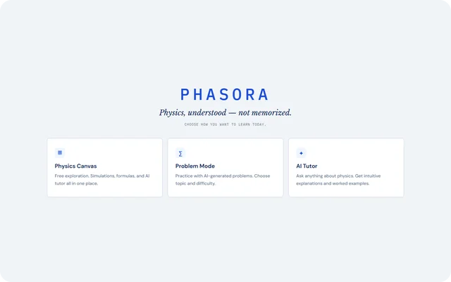</a>
      <h3>Phasora</h3>
      
An early-stage AI physics tutor that gives hints instead of answers. It has 2 concept pages so far.

      
<a href="https://phasoraai.com"><b>Visit site</b></a>

      Private repo. React, Vite, KaTeX, Anthropic API
    </td>
    <td width="33%" valign="top">
      <a href="https://sofiakamal.art">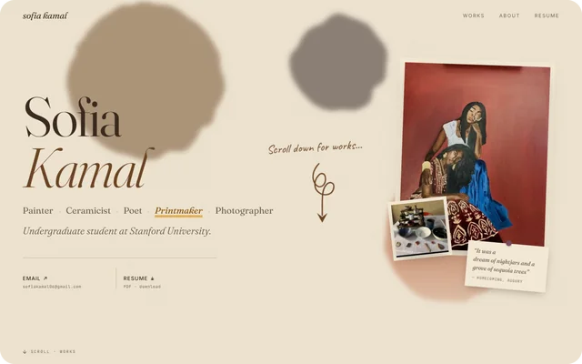</a>
      <h3>Artist Portfolio</h3>
      
A portfolio for a Stanford artist, with 58 works across 5 mediums and a custom watercolor page transition.

      
<a href="https://sofiakamal.art"><b>Visit site</b></a>

      Private repo. React, Node.js, esbuild
    </td>
    <td width="33%" valign="top">
      <a href="https://www.azrussianrealtor.com/">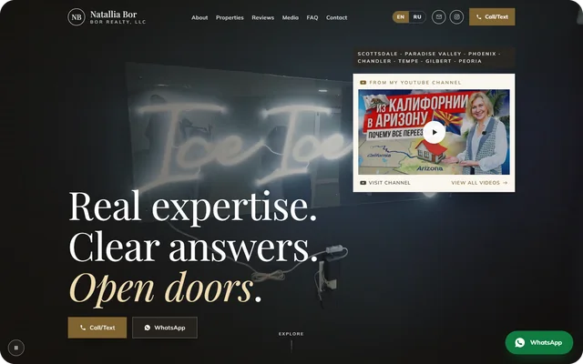</a>
      <h3>BOR Realty</h3>
      
A bilingual English and Russian site for a Phoenix real estate brokerage, with a video library that updates itself every day.

      
<a href="https://www.azrussianrealtor.com/"><b>Visit site</b></a>

      Private repo. Next.js, TypeScript, Tailwind CSS
    </td>
  </tr>
</table>

 

  Many of these projects are AI-assisted, built with Claude Code and Codex.

